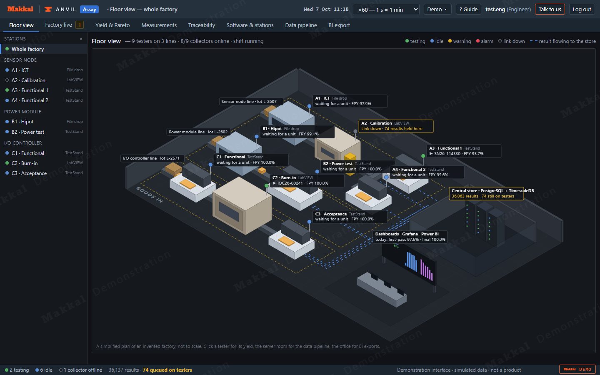
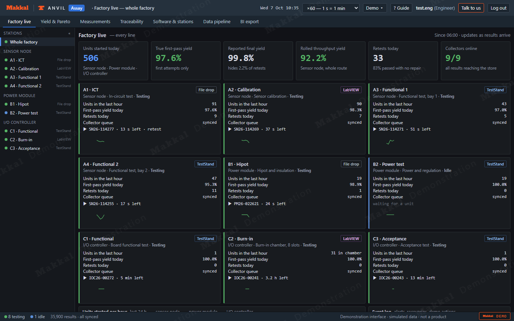
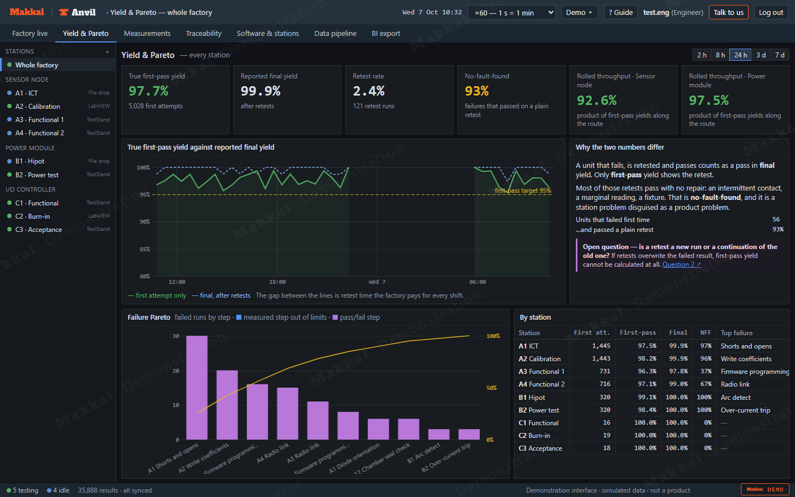
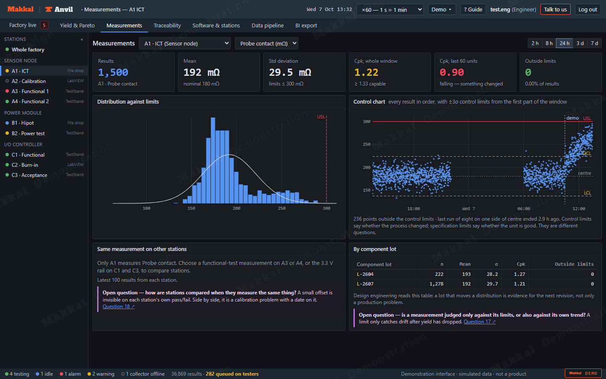
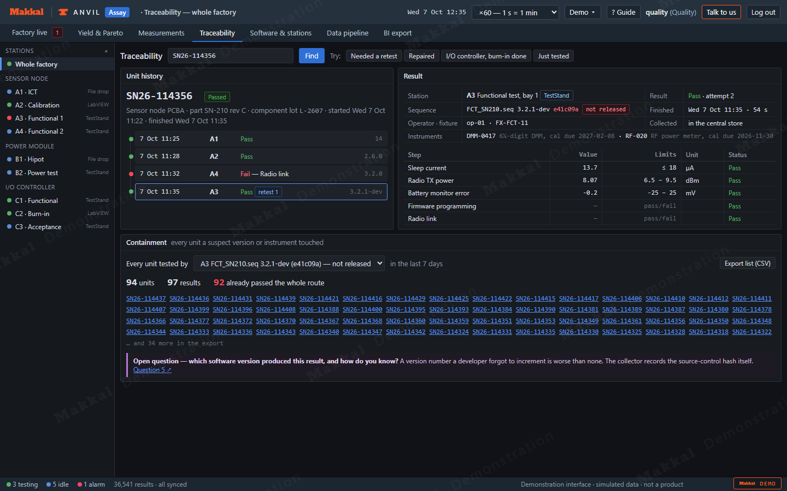
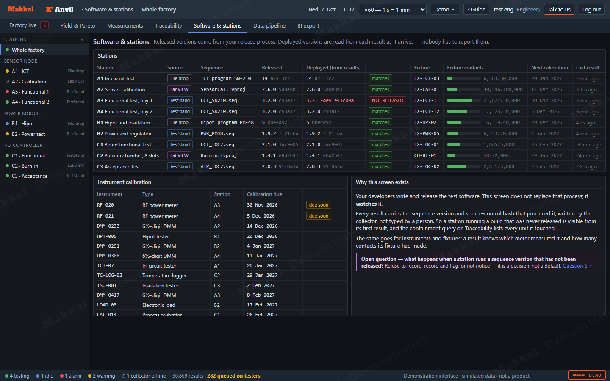
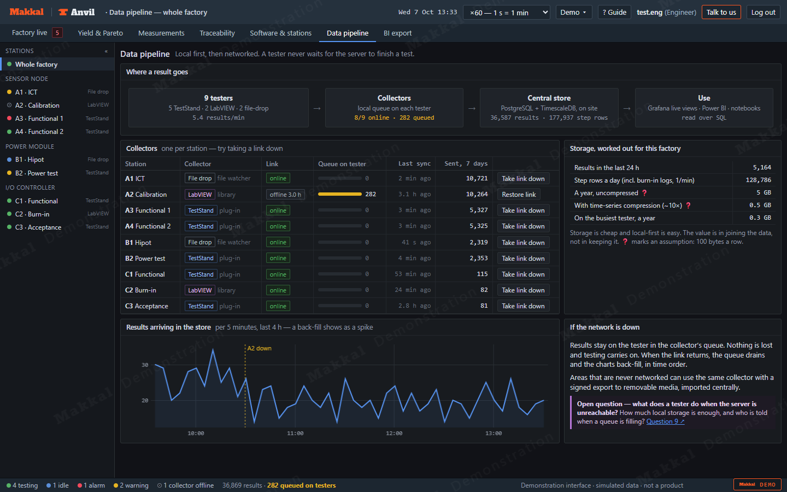
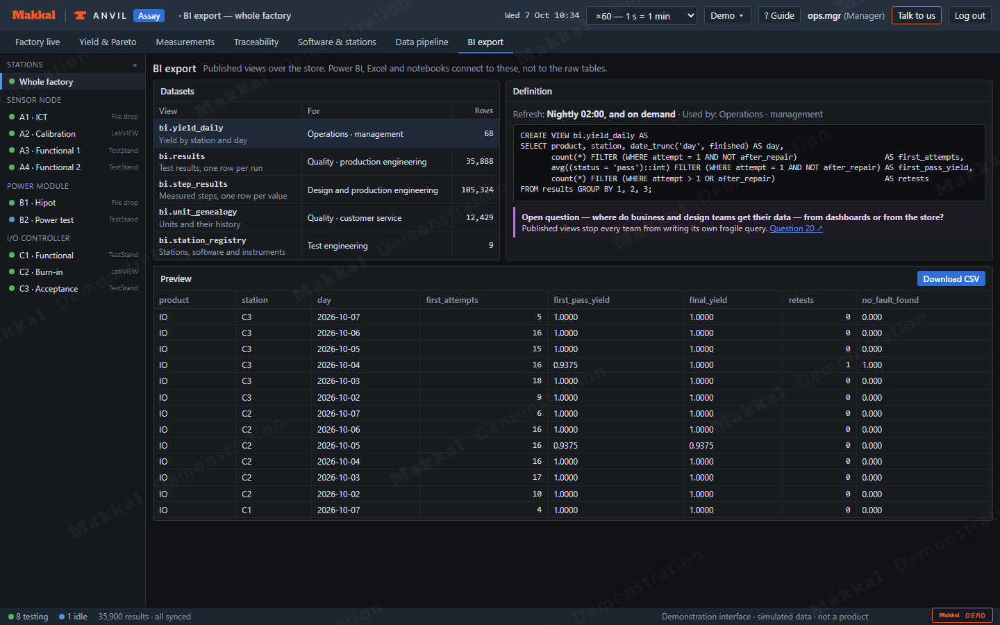

<p align="center">
  <a href="https://makkal-co.github.io/anvil-assay-demo/">
    <picture>
      <source media="(prefers-color-scheme: dark)" srcset="docs/img/logo-dark.svg">
      
    </picture>
  </a>
</p>

# Anvil Assay — production test data

*Anvil is Makkal's family of reference test systems. Assay is the one for production test data.
[Anvil Temper](https://github.com/makkal-co/anvil-temper-demo) is its sibling for
durability test stands.*

**Your engineers keep writing the tests. We make every result land in one place, with the software
version that produced it, and turn it into decisions.**

[Makkal](https://makkal.co) builds test-system software on **NI CompactRIO, CompactDAQ, LabVIEW and
TestStand**, and the data layer behind it. This repository is a working demonstration of that data
layer for an electronics factory. Three product lines and nine testers — TestStand sequences, LabVIEW
applications and vendor testers that only drop files — all collected into one store, local first and
then networked, with dashboards for yield, traceability, drift and software versions.

### ▶ [Open the live demo](https://makkal-co.github.io/anvil-assay-demo/), or open `index.html` locally

No install, no sign-up, no network. Pick a role and go. Press **Talk to us** in the header whenever
something looks like your factory.



*The floor view: three lines, nine testers, the server room and the dashboards. Here station A2 has lost its network link: its cable is grey and its results are queuing beside the tester.*

> **A demonstration, not a delivered system.** The products, stations, results and people are all
> invented, and the factory behind the screens is a simulation. What is real is the way it is built.

---

## Is this your factory?

| What you are living with | What a system like this gives you |
|---|---|
| Every tester writes its own files, in its own format, to its own disk | One result model and one store, fed by small collectors on each tester |
| "Our yield is 99%" — but retests hide inside it | True first-pass and rolled throughput yield, counted from every attempt |
| A unit comes back from the field and nobody can say what tested it | Every run against the serial: station, instruments, operator, fixture, and the **software version and source-control hash** |
| A station runs a build that was never released | Deployed versions read from the results themselves, and a containment query listing every unit it touched |
| A fixture or an instrument drifts, and you find out when yield drops | Cpk and control charts per measurement, and station-to-station comparison |
| Some testers are not on the network | Collectors that queue locally and back-fill when the link returns — nothing lost |
| Management wants a weekly report built by hand | Published views for Power BI and Excel, off the same store |

---

## Try it in five minutes

Open `index.html` and pick a role; there is no password. The **Guide** opens on its own. Press
**? Guide** in the header to bring it back at any time. It offers two kinds of tour:

- **The walkthrough.** Every screen, one panel at a time, starting with the **floor view** and then **Yield & Pareto**: what you
  are looking at, and why it matters. It takes about three minutes.
- **Five scenarios.** Each one injects a fault from the **Demo ▾** menu and moves the factory clock
  on a few hours so the fault has something to show. It then takes you to every screen where the
  fault appears, and ends with the fix.

| Scenario | What happens in the factory | Where it shows |
|---|---|---|
| **Fixture wear** | The ICT fixture's probes wear: contact resistance creeps up and worn pins cause occasional opens | **Measurements**: Cpk falls and the control chart climbs towards its limit while yield barely moves. **Yield**: no-fault-found rises |
| **Instrument out of calibration** | A meter on one of two identical functional testers reads 11 mV high and is past its calibration date | **Measurements**: station-to-station bias. **Software & stations**: calibration overdue. **Traceability**: every unit that meter measured |
| **Component-lot shift** | Power modules move to a new component lot that costs a point of efficiency | **Measurements**: the distribution moves towards its limit, and the split by lot shows why. **BI export**: the dataset for design engineering |
| **Unreleased test build** | A development build of the functional test is copied onto one station | **Software & stations**: deployed version differs from released. **Traceability**: containment lists every unit it tested |
| **Network outage** | One station loses its network link for an hour | **Factory live** and **Data pipeline**: results queue on the tester, then back-fill when the link returns |

You can also break things yourself from **Demo ▾**, and set the speed to ×600 to watch a shift go
by. A scenario changes the simulated factory. Use the fix at the end of the scenario, or reload the
page to start again.

| | |
|---|---|
|  **Factory live** — every station, true first-pass against reported yield |  **Yield & Pareto** — first-pass vs final, RTY, Pareto |
|  **Measurements** — a worn fixture caught by Cpk and SPC |  **Traceability** — unit history and containment |
|  **Software & stations** — released against deployed |  **Data pipeline** — local first, then networked |
|  **BI export** — published views for Power BI and Excel |  |

---

## What sits behind a system like this

| Layer | What we use | What we decide with you |
|---|---|---|
| **Testers** | Your TestStand sequences, LabVIEW applications, Python scripts and vendor testers (ICT, hipot, burn-in), on NI PXI, CompactDAQ, CompactRIO or general-purpose instruments | Which stations join first, and what each one already writes |
| **Collectors** | A TestStand result-processing plug-in, a LabVIEW and Python results library, a file watcher for testers that only drop files | The result model: what identifies a unit, a run, a retest, a version |
| **Local queue** | Store-and-forward on every tester; a signed export for areas that are never networked | Local storage, and who is told when a queue fills |
| **Store** | PostgreSQL with TimescaleDB, on your premises; raw files and waveforms on a share | Retention per product, data classification, who may see what |
| **Use** | Grafana for live operational views and alerts; published SQL views for Power BI, Excel and notebooks | Which decision each dashboard serves, and who acts on it |
| **Governance** | Released vs deployed sequence versions, instrument calibration, fixture contact counts | Whether an unreleased version is refused, flagged or allowed |

Open components, no per-station licence, and **you own the source**. The data layer depends on no
single instrument vendor.

## How we work with an in-house test team

Many factories have their own test developers and want to keep it that way. So do we.

1. **One line, two or three stations.** Collectors installed, local queues running, a central store,
   the first yield and traceability views.
2. **The result model, agreed together** — usually the most valuable conversation of the project, and
   the one the twenty questions below are for.
3. **Line by line**, with your team installing collectors from the second line onwards.
4. **Business and design views**, once there is enough history to be worth reading.
5. **Handover.** Source, documentation, runbooks. Your team extends it without us.

## Twenty questions your specification does not answer

**[docs/questions.md](docs/questions.md)** — what identifies a unit, whether a retest is a new run,
which software version produced a result and how you know, what a tester does offline, whose clock is
right, who owns the limits. Most of them change the design.

## Talk to us

Tell us what you build and test, what runs your tests today (TestStand, LabVIEW, vendor testers),
roughly how many stations, and what hurts most.

**Email [support@makkal.co](mailto:support@makkal.co)**, press **Talk to us** inside the demo, or
visit **[makkal.co](https://makkal.co)**.

---

## What this demo does not model

- **No real database or Grafana.** The demo draws its own panels from a simulated store in the
  browser. A runnable reference stack (TimescaleDB, Grafana, collectors) is a separate piece of work.
- **No real TestStand or LabVIEW integration.** The collectors are simulated.
- **Statistics are real, data is not.** FPY, RTY, Cpk and control limits are computed properly, on
  invented results.
- Measured steps all run even after one fails; a real sequence would usually stop.
- No MES or ERP write-back, no user management, nothing persisted. Reloading resets everything.

## About the demo itself

Plain HTML, CSS and JavaScript, no framework, no build step, no network. It runs from `file://`.

```
index.html        frame, login, logos, inlined favicons
js/data.js        products, stations, measurements, limits — the factory lives here
js/sim.js         the factory: arrivals, retests, repairs, collectors, faults, alerts
js/stats.js       first-pass yield, RTY, Cpk, Pareto, control limits
js/scr-*.js       one file per screen; scr-floor.js draws the isometric floor plan
js/tour.js        the Guide: the walkthrough and the five scenarios
docs/             the question set and README screenshots
assets/icons/     favicon sources
```

Deep links for rehearsing a demo:

```
index.html#user=test.eng&screen=yield
index.html#user=test.eng&screen=meas&st=A1&fault=wear&adv=180
index.html#user=quality&screen=trace&fault=dev&adv=120
```

`fault=` takes `wear`, `cal`, `lot`, `dev`, `offline`; `adv=` moves the clock on by that many
simulated minutes. `tour=3` opens the walkthrough at step 3. `scenario=wear&step=2` runs a scenario
from the step given; the scenario names are the same as the `fault=` values. To check a change without clicking:

```
chrome --headless=new --screenshot=shot.png --window-size=1440,900 --virtual-time-budget=3000 \
  "file:///path/to/index.html#user=test.eng&screen=live"
```

Script errors render as a red banner at the bottom of the page.

---

*[Makkal](https://makkal.co) builds test-system software (DAQ, control, HMI and data), mostly on NI
platforms. Demonstration interface. Simulated data. Not a product.*
